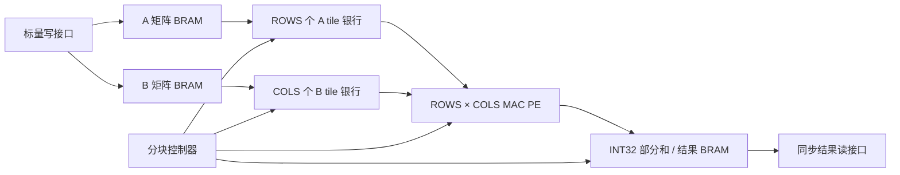

# 阶段二 W4A8 当前入口

现已新增独立流式分组量化顶层，原 INT8/NPU 实现与历史报告保留。当前规格及实际结果见 [W4A8 架构](w4a8_architecture.md)、[数值规格](w4a8_numerics.md)、[验证](w4a8_validation.md)、[性能](w4a8_performance.md)、[后续计划](w4a8_next_steps.md)。以下为既有基线记录，资源数字不代表新 W4A8 顶层。

---

> 当前工程增加了 NPU 有序任务前端 npu_top，详见 [npu_architecture.md](npu_architecture.md)。本文描述其内部 matmul_top 计算引擎；原核心接口仍可独立使用。

# 架构与同步接口

本工程自主实现一个片上 INT8 GEMM 基线，C[M,N]=A[M,K]×B[K,N]。默认 OPTIMIZED=1、DOUBLE_BUFFER=1、B_LOAD_GAP=0、ROWS=4、COLS=4、TILE_K=8、MAX_M=MAX_N=16、MAX_K=32。参数为编译期容量，任务尺寸在 start 握手时锁存。已仿真的第二配置为 ROWS=2、COLS=3、TILE_K=5，容量相同。扩展容量需重新综合；当前计数器为 16 位，建议容量与 tile 参数均不超过 32767，且阵列乘积不超过 32767。参数必须为正整数。

## 模块与数据流



| 文件 | 职责 |
|---|---|
| rtl/mac_pe.sv | 有符号 8×8 乘法、显式 16→32 位符号扩展、32 位累加 |
| rtl/mac_array.sv | 将每行一个 A、每列一个 B 广播到 ROWS×COLS PE |
| rtl/sync_sdp_ram.sv | 一个同步读端口、一个同步写端口；禁止整片 RAM 复位 |
| rtl/tile_buffer.sv | LANES 个独立银行，每银行 TILE_K 个 INT8，标量写、并行同步读 |
| rtl/matmul_top.sv | 矩阵 Buffer、部分和 Buffer、FSM、接口、周期计数 |

原始模式 OPTIMIZED=0 的实现如下。优化模式沿用相同接口、元素映射和 PE 数值规则，其差异见文末“优化模式”。

选择 output-stationary 是因为每个输出元素的归属明确，无需第一版引入 systolic skew 或转发网络。PE(r,c) 始终计算当前输出 tile 的 C[mt+r,nt+c]。K tile 改变时保留 PE 累加器，输出 tile 改变时执行 CLEAR。每个 K tile 结束后，标量保存所有有效 PE 部分和到 BRAM；该 BRAM 保存片上 checkpoint（当前外部接口仅在任务完成后允许读取最终结果），跨 K 的权威部分和仍保留在 PE 寄存器中，因此无需 checkpoint 重读。任务完成后 BRAM 的所有有效位置均为最终结果。尚不支持输出 tile 上下文切换或从 checkpoint 恢复。

## 元素映射与端口预算

矩阵 Buffer 使用固定容量步长，未按任务尺寸压缩：

- A 的物理地址为 row×MAX_K+col，深度 MAX_M×MAX_K，宽度 8 位。
- B 的物理地址为 row×MAX_N+col，深度 MAX_K×MAX_N，宽度 8 位。
- P 的物理地址为 row×MAX_N+col，深度 MAX_M×MAX_N，宽度 32 位。
- A tile 第 r 银行的地址 q 保存 A[mt+r,kt+q]。B tile 第 c 银行的地址 q 保存 B[kt+q,nt+c]。

A、B 矩阵 Buffer 各只有一个读端口和一个写端口。FSM 先装载 A，再装载 B，每个元素用 REQ、WRITE 两个周期：REQ 的上升沿进行同步 RAM 读，WRITE 的下一上升沿写入 tile 银行。没有同周期任意多地址访问的矩阵数组。原始模式 tile Buffer 使用 ROWS+COLS 个银行，每银行一个读端口，每个计算周期读共同 q 地址；每行 A 广播到 COLS 个 PE，每列 B 广播到 ROWS 个 PE。并行供数为 8×(ROWS+COLS) 位/周期，默认 64 位/周期。

每个 tile 都完整装载 TILE_K 个地址。超出任务 M、N、K 的元素禁止原始矩阵 RAM 读，并向 tile Buffer 写零。RUN 仅执行 k_len=min(TILE_K,K−kt) 次，因此旧 tile 数据和无效 K 尾元素不参与结果。SAVE 仍遍历 ROWS×COLS 个 PE，但越过 M、N 的位置禁止 P 写入。无效 PE 可以算零，外部结果接口无法访问无效坐标。

RAM 数组不等同于最终物理 RAM：矩阵与 P 请求 block RAM，tile 请求 distributed RAM；最终是否成为 BRAM、LUTRAM 或寄存器必须以综合报告为准，见 validation.md。RAM 无复位，读数据在无 rd_valid 时可能为旧值或仿真 X，软件不得使用。内存读写同地址的行为在本协议中不会被依赖：矩阵写仅空闲，矩阵读仅 busy；tile 装载与计算分阶段；P 写仅 busy，外部读仅空闲。

## 状态与结果时序

| 状态 | 每个使能上升沿的动作 | 周期数 |
|---|---|---:|
| CLEAR | 将所有 PE 累加器设为零；启动一个输出 tile | 每输出 tile 1 |
| A_REQ / A_WRITE | 同步读 A，然后写一个 A tile 元素；无效坐标写零 | 2×ROWS×TILE_K |
| B_REQ / B_WRITE | 同步读 B，然后写一个 B tile 元素；无效坐标写零 | 2×COLS×TILE_K |
| PRIME | 同步读所有 tile 银行的 q=0 | 每 K tile 1 |
| RUN | PE 消耗已寄存的 A、B；同步读下一 q | 每 K tile k_len |
| SAVE | 每周期写一个有效 PE 的 INT32 checkpoint | 每 K tile ROWS×COLS |
| ADVANCE | 进入下个 K tile、下个输出 tile，或完成任务 | 每 K tile 1 |

PRIME 上升沿后 q=0 的操作数有效；第一个 RUN 上升沿累加 q=0，同时寄存 q=1；最后一个 RUN 上升沿完成最后一项累加，下一 SAVE 上升沿才能读取更新后的 acc。无额外乘法流水线，RUN 内每周期一次 MAC。暂停时 FSM、RAM 读写和 PE 更新全部停住，操作数寄存器与部分和保持，恢复后的 RUN 使用同一组数据，不重复或跳过 K。

对于原始模式 OPTIMIZED=0，令 O=ceil(M/ROWS)×ceil(N/COLS)，T=ceil(K/TILE_K)。从 start 接受之后到 done 上升的有效 busy 周期为：

```text
active_cycles = O × [1 + T × (2×TILE_K×(ROWS+COLS) + ROWS×COLS + 2) + K]
cycle_count = active_cycles + busy 期间 pause=1 的周期数
```

计数器为 32 位，极长任务计数自然回绕。上述公式不包括 start 接受的那个上升沿，不包括主机加载 A/B 或结果读回时间。TB 和 Python 独立计算公式并核对每个任务。

## 数值规则

输入为二进制补码 INT8，范围 −128…127。乘积为有符号 INT16（−16256…16384），先复制符号位扩展到 32 位，再累加。每次加法保留低 32 位，输出按有符号 INT32 解释；不饱和，不报算术溢出。Python 使用任意精度整数执行乘法，并在每次加法后执行相同模 2^32 回绕。PE seed 端口用于通用 PE 初始化与独立溢出验证，顶层只将其加载为零。默认 K≤32 的合法矩阵不会自然产生 INT32 溢出，因此矩阵验证与 PE 溢出验证分别记录。

## 顶层协议

所有信号在 clk 上升沿采样，单时钟、同步高有效 rst。一次只发一种命令：输入写、start 或输出读；同时拉高多种请求时各 ready 为零，没有内部请求队列。请求可保持至对应 ready=1，握手定义为请求与 ready 在同一上升沿均为 1。

| 信号 | 行为 |
|---|---|
| wr_valid / wr_ready | 写一个 INT8；wr_matrix=0 写 A、=1 写 B；wr_row/wr_col 为逻辑坐标 |
| cfg_m/cfg_n/cfg_k | 正数且不超过容量；只在 start && start_ready 时锁存 |
| start / start_ready | 空闲、非暂停且无其它命令时可启动；尺寸非法产生一周期 error，不进入 busy |
| busy | 任务执行期间为 1，禁止输入写、结果读和新 start |
| done | 最后一次 ADVANCE 后的一周期完成脉冲 |
| error | 仅非法尺寸或非法 FSM 状态产生一周期脉冲；算术回绕不触发 |
| result_available | 完成后保持 1，接受新任务、任何输入写或 rst 时清零 |
| rd_req / rd_ready | 完成且空闲时，坐标有效才接受同步读 |
| rd_valid / rd_data | 请求接受的上升沿后返回该坐标的 INT32；rd_valid 一周期，无响应端背压 |
| pause | ready 全部为 0；busy 任务冻结但 cycle_count 继续计时；active_cycles 停止 |

尺寸为 0 或超过 MAX_* 的 start 被接受后拒绝，保留之前已完成结果；没有无声截断任务。无效写坐标、无效读坐标直接使对应 ready=0，调用方应自行纠正，硬件不会报 error。busy 期间命令不被接受，保持单个请求到空闲可能在未来被接受。读响应不提供 ready，调用方必须在 rd_valid=1 时采样；可连续逐周期读不同坐标。rd_valid 在 rst 时立即按同步语义清零。

复位持续至少一个上升沿：中止正在运行的任务、清空 PE、状态和计数器，busy/done/error/rd_valid/result_available 清零。矩阵 RAM 与 P RAM 保留物理内容，但旧结果不可访问；复位后调用方可复用已经完整装载的 A/B，也可重新装载。硬件不跟踪哪些输入已写，启动前完整写入本任务有效范围是调用方的职责。连续任务无需复位；每个输出 tile 必经 CLEAR，旧部分和不会污染下一任务。


## 单缓冲优化模式 OPTIMIZED=1、DOUBLE_BUFFER=0

保持 output-stationary 和单标量主机接口，新增激活复用与装载流水。B 仍是 K tile；A 银行扩展为每行 MAX_K 个 INT8，保存当前 M 块全部有效 K，跨不同 N 输出块复用。A 银行地址 q 保存 A[mt+r,q]，计算时读 kt+q；B 银行地址 q 仍保存 B[kt+q,nt+c]。默认 A cache 为 4×32=128 字节，B tile 为 4×8=32 字节，原始 A/B tile 合计 64 字节。第二配置 MAX_K=32、TILE_K=5 已仿真，证明两类地址宽度独立。

### 同步读流水与端口

每次装载先经过一个 REQ 上升沿，读取第一个标量。WRITE 上升沿用此前寄存的 RAM q 写当前 cache/tile 地址，同时用同一个源 RAM 读端口请求下一个标量；下一 WRITE 消耗下一 q，直到最后一个标量。首拍启动后 II=1，没有增加矩阵 RAM 端口，也没有组合 RAM 读。A 与 B 装载仍分阶段；没有双缓冲或装载/计算重叠。

WRITE 时源读地址属于 next_lane/next_k，而 tile 写地址属于 load_lane/load_k，不能使用同一地址索引检查两者。下一元素无效时禁止源读，下一 WRITE 根据其逻辑坐标写零，不消费旧 q。最后一拍不请求下一元素。pause 同时关闭源读和 tile 写、冻结全部索引；已寄存的待写 q 保持，恢复后继续同一拍。

A cache 仅在 nt=0、kt=0 时装载 ROWS×K 个位置，其中超过 M 的行写零；每个新 M 块和新任务均重新装载。循环顺序仍为 M→N→K，因此同一 M 块在 N 循环中不会被覆盖。复位后 cache 物理内容可保留，但新任务必经首块重装，不依赖旧有效标志。B 每个 K 块装载 COLS×k_len 个位置，其中超过 N 的列写零。不会读超过任务 K 的源地址，也不读取未装载的 K 尾位置。

### 控制状态

| 状态 | 优化模式行为 |
|---|---|
| CLEAR | 每输出块清 PE；nt=0 进入 A_REQ，否则直接 B_REQ |
| A_REQ / A_WRITE | 一次启动拍 + ROWS×K 个连续写拍，只在每个 M 块一次 |
| B_REQ / B_WRITE | 一次启动拍 + COLS×k_len 个连续写拍，每 K tile 一次 |
| PRIME / RUN | 与原始模式相同；A cache 使用绝对 K 地址 |
| SAVE | 仅最后 K tile 执行 ROWS×COLS 拍，写最终结果 |
| ADVANCE | 中间 K tile 直接 B_REQ；输出 tile 切换时 CLEAR |

中间 K 的部分和继续驻留 PE，不写外部不可见的 checkpoint。部分和 BRAM 在任务完成后承载所有有效最终输出。仍未实现上下文切换/部分和恢复。

令 U=ceil(M/ROWS)、V=ceil(N/COLS)、O=U×V、T=ceil(K/TILE_K)，优化活动周期为：

```text
active_cycles = U×(ROWS×K+1) + O×(1+COLS×K+3×T+K+ROWS×COLS)
A 源读取次数 = M×K
B 源读取次数 = U×K×N
P 有效写回次数 = M×N
```

公式中的 3×T 分别对应 B 启动拍、PRIME、ADVANCE。每块的 CLEAR 和固定 PE SAVE 遍历均包括在内。尾块仍对无效 M/N lane 写零和遍历，无越界源读/P 写。原始模式 A 源读取为 V×M×K、P 写回为 T×M×N；这些端口计数和周期公式均在 TB 中逐任务核对。

默认 16×16×32 实测 3540 活动周期：A 装载 516、B 装载 2112、RUN 512、CLEAR 16、PRIME 64、SAVE 256、ADVANCE 64。RUN 占比 14.46%；相同阵列的理论峰值仍为 16 MAC/周期。主机写入/读回未包含，100 MHz 是约束目标，无板上性能测量。

## B tile 双缓冲（当前默认）

rtl/b_pingpong.sv 是独立装载器与两个 B tile 银行组，每组 COLS 个银行，每银行 TILE_K×8 位、一个同步读/一个同步写端口。默认 B tile 存储由 32 字节增加到 64 字节；A 保持完整行 cache 128 字节。完整矩阵 A/B/P 的源 RAM 端口数量不变。B 源只允许一个标量读/周期，两个 tile 组分别写与读，没有多端口数组模拟带宽。

DOUBLE_BUFFER=1 仅在 OPTIMIZED=1 时生效；OPTIMIZED=0 使用原始模式。DOUBLE_BUFFER=0 使用上一轮单缓冲。B_LOAD_GAP 必须为非负整数，默认为 0；正值在装载器每个请求/提交拍后插入固定独立空拍，消费者继续计算，用于验证等待路径。它不表示已经实现 DDR 响应协议或可变读延迟。

### 银行归属与标签

每个银行组的所有权状态独立：

~~~mermaid
stateDiagram-v2
  EMPTY --> FILLING: 装载器领取并同步读首元素
  FILLING --> READY: 最后一拍写入完成
  READY --> COMPUTING: WAIT_B 接受当前 K 标签
  COMPUTING --> EMPTY: ADVANCE 释放当前 tile
~~~

- producer_bank 与 consumer_bank 从 0 开始，分别在领取与释放后交替。
- 每组有 bank_kt 标签，领取时写入其绝对 K 起点；只允许顺序消费。
- CLEAR 初始化本输出块的 n_base、任务 K/N、银行归属与游标，同时清 PE。下一拍可开始 B 预取。
- 首个 N 块的 A 装载与 B 预取并发；A 完成或其它 N 块 CLEAR 后，主 FSM 进入 WAIT_B。
- WAIT_B 只有当前 consumer_bank=READY 时才 take，下一拍进入 PRIME，再下一拍 RUN。消费同步读后数据。
- 当前 K 块完成后，ADVANCE 释放 COMPUTING 组并翻转消费者。下一 K 块重新 WAIT_B；银行尚未 READY 时保持等待。
- 装载器只领取 EMPTY 组；COMPUTING 未释放前不可覆盖。两个组都占用时装载器停止，消费者仍可运行。
- 最后一个 K 块仍经过 SAVE 和 ADVANCE。下一个输出块 CLEAR 重新初始化归属，不跨输出块预取。

FILLING 使用同步标量流水：领取拍读第一个源标量，随后提交拍把此前 q 写入 tile，同时读下一个标量。最后提交拍设置 READY，不再请求下一标量。无效 N lane 不读源 RAM而写零；只装载有效 k_len，RUN 不读 K 尾块中的旧地址。

### 并发暂停与复位

pause 同时冻结主 FSM、装载器、间隔计数器、银行状态、标签和 RAM 使能。消费者和生产者恢复同一拍，不重复 K 项或覆盖待消费数据。同步 rst 中止任务并将两个组归属设 EMPTY、清游标和 PE；RAM 内容保留，但新任务 CLEAR 后重新装载，不能消费旧 READY 数据。

源 B 读地址与计算 kt 已解耦：源地址使用装载器 request_kt/request_k、固定 MAX_N 步长，不能拿消费者 kt 做源地址边界断言。TB 分别检查源坐标、tile 写坐标、计算 bank_kt 和所有权。

### 精确活动周期模型

双缓冲的装载与计算重叠，不能把各阶段周期简单相加。Python 和 TB 分别实现下面的事件时间递推；时间按输出块 CLEAR 为第 1 个活动周期计，暂停周期不参加递推。

~~~text
A = ROWS×K+1（当前 N 块为 0）；否则 A=0
上一消费者释放时刻 R[-1] = 1+A
第 i 个 K tile 有效长度 L[i] = min(TILE_K, K-i×TILE_K)
G = B_LOAD_GAP

领取时刻 S[0] = 2
S[i>0] = F[i-1]+G+1
i≥2 时 S[i] = max(S[i], R[i-2]+1)    # 等待复用的同组释放
填充完成 F[i] = S[i] + COLS×L[i]×(G+1)
消费者领取 T[i] = max(R[i-1]+1, F[i]+1)
释放 R[i] = T[i]+L[i]+2
最后 K tile 再加 ROWS×COLS 个 SAVE 周期
~~~

T[i] 到 R[i] 包括 PRIME、RUN 和 ADVANCE；WAIT_B 的领取本身单独占一拍。同一上升沿释放的组只能下一拍领取，最后写入 READY 的组也只能下一拍 take，递推包含这两种同步边界。

任务活动周期为 ceil(M/ROWS)×[首 N 块的 R[last] + (ceil(N/COLS)-1)×其它 N 块的 R[last]]。尾 M/N 组仍遍历固定 lane 数，源读/P 写按有效坐标屏蔽。A/B/P 的有效访问次数与上一轮单缓冲相同；双缓冲减少等待，不减少 B 总读取字节数。

默认 16×16×32 实测为 2856 活动周期，单缓冲 3540；其中 352 拍同时 RUN 与 B tile 写、1364 拍为 WAIT_B 未就绪。带暂停用例实测 elapsed=3238、pause=382。RUN 仍为 512 拍，约占 17.93%。双缓冲未隐藏全部装载：默认满 tile 要 33 个装载拍，而 RUN 只有 8 拍，源标量端口仍限制吞吐。详见 [double_buffer.md](double_buffer.md)。
