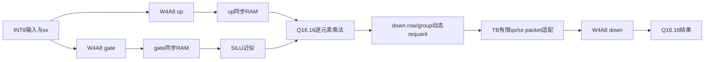

# C/E 小型 FFN 接口与生命周期

推荐功能基线：原 `rtl/w4a8_wave.sv` 的三次投影，加独立 `rtl/vector/ffn_bridge.sv` 中间通路。参考 `model/vector/ffn_reference.py`，完整自检 `tb/vector/tb_w4a8_ffn.sv`，入口 `scripts/run_ffn.ps1`。本轮按功能顺序执行，未加入输出FIFO或tile重叠。

GR、UR、S、P、Q都在可综合bridge中；三次W4A8核心已有独立综合证据，完整三投影通过TB组合验证。packet适配及任务阶段调度为TB，不宣称已综合统一FFN任务顶层、外存搬运或写回。队友A/D负责任务图/软件与统一控制，B/F负责qx/sx存储和packet供数。

## 描述符与输入

`ffn_bridge`默认GROUP_SIZE32、MAX_M/H64、CAPACITY512，GROUP_SIZE是编译参数，验证32/12。`cfg_valid/cfg_ready`在posedge接受一个m/h描述符；m/h非零、不超MAX、m×h≤CAPACITY，否则done单拍、error_code1，无输入/输出事务。busy期间cfg_ready=0；描述符由生产者在接受前持稳。

输入是单个valid/ready通道：`in_branch=0`为gate，1为up，`in_row/in_col`是全矩阵坐标，`in_data`是signed32 Q16.16。每任务每branch每有效坐标恰好一个元素。两个分支可以交错、任意坐标顺序；同时两生产者需上游仲裁，本模块只有一个写入接受口。未接受时生产者持稳全部payload。

每branch一个CAPACITY×32同步1R1W RAM，地址row×h+col；两组CAPACITY位seen标记检测重复及未初始化读取，RAM不复位。越界/重复输入在接受拍拒绝、不写RAM，error_code2、done单拍，任务返回IDLE。缺失坐标不会隐式补0：模块等待余下元素，系统watchdog由控制方负责，TB具备非零超时检测。

## 中间通路

两分支m×h有效元素全部接受后才开始读取；采集期不读、运算期不再接收输入。按row和down的K-group顺序发dynamic描述符，再依次读取同坐标gate/up，PAIR_REQ同步读一拍，PAIR_SEND送入标量SwiGLU。scalar输出接受后送dynamic收集。整组收集完成后等待qx输出，最终qx接受后才能开始下一组；整个任务最后qx接受才释放两个RAM。

`swiglu_element`是独立valid/ready标量接口，输入含gate/up和row/col标签；从输入接受到out_valid为6拍，无背压最小输入接受间隔8拍。输出out_silu、out_data均Q16.16，标签与out_saturated持稳直到接受；HOLD期间不收新输入。bridge每元素额外同步读/送入/状态推进，吞吐未优化；实际阶段周期见CSV。

## 输出与完成

| 信号 | 含义 |
|---|---|
| out_valid/out_ready | qx接受握手；背压保持数据、标签及group状态 |
| out_data | signed8 qx |
| out_row/out_group/out_index | row，down K-group，本组内index；全列=group×GROUP_SIZE+index |
| out_scale | unsigned16 UQ4.12，组内每元素重复；适配器按row/group存一次sx |
| out_last | 当前量化组最后元素 |
| out_task_last | 当前任务最后元素，须与out_valid一起判断 |
| out_saturated/group_saturated | 当前元素/当前group动态量化饱和 |
| scale_clipped/group_absmax | 当前量化group的scale范围不足/unsigned32 absmax |
| nonlinear_saturated | 当前任务累计SiLU/乘法饱和，完成时为最终值 |
| done/error_code | 最后qx接受或拒绝时done单拍；0成功、1非法描述符、2非法坐标 |

`bridge.done`仅说明中间qx/sx产生并被下游接受，不表示down投影完成。down `out_last`接受也不等于外存writeback_committed。统一控制需分别等待中间张量存储确认、down核心done与外存写确认，才能向软件报告FFN任务成功。

同步rst取消整个任务、scalar和quant流水及未接受输出，清seen和控制状态但不清RAM；恢复任务必须重新配置并完整写入两分支有效坐标。rst时cfg_ready/in_ready/out_valid=0。error_code保持到新描述符或复位。

## 完整自检范围与接续

TB使用三个原4×4 W4A8实例，gate/up顺序启动，按实际tile输出坐标写RTL bridge。bridge的qx/sx写有限的down packet源，全部m×h qx和m×ceil(h/GROUP_SIZE) scale确认后才启动down，down sw独立。矩阵m×k→h→n：1×19→37→5、3×35→29→7、5×23→61→6、2×13→25→3零矩阵、1×9→33→4故意饱和矩阵。未测滿MAX_K/M/N。

共同对齐：任务ID和存储地址由统一顶层携带，本bridge只有单活动任务；gate/up的布局任意坐标输入，down按row/group顺序输出；sx随qx epoch保持，独立down sw不能取gate/up的sw。实际缓冲、舍入、拒绝、复位与写确认边界由本文定义，不修改现有W4A8共享接口。

下一步优先将有限qx/sx存储与任务图适配交给A/D、B/F集成；C/E再补Transformer其余数值算子（RMSNorm、RoPE、Attention归约/Softmax及残差）。输出FIFO/有效槽版本的FFN替换属于后续性能工作，保留当前顺序基线回归。
