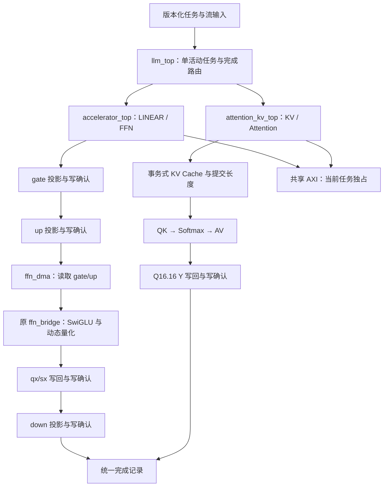

# ABI v2：统一系统架构

当前主顶层为 `rtl/llm_top.sv`，硬件参数与软件入口由 `config/system_profile.json` 描述，综合与仿真共用 `config/system_sources.txt`。`scripts/project.py` 负责生成参考数据、编译、仿真、实现与当前源码证据校验。

## 公共任务与总线所有权

主机以 `job_valid/job_ready` 提交一个完整任务。顶层锁存 opcode 和相应描述符，在 ISSUE 阶段交给子系统；一个任务完成并由主机接收完成记录后，才接受下一个任务。所有共享 AXI 的读写响应都返回当前所有者，子系统没有独立接收新任务的旁路。

| opcode | 名称 | 描述符 | 成功边界 |
|---:|---|---|---|
| 0 | LINEAR | `bounded_task_t` | 全部 Q16.16 结果收到 AXI B response |
| 1 | FFN | `ffn_plan_t` | gate、up、SwiGLU/requant、down 顺序完成，最终 down 写确认 |
| 2 | ATTENTION | `attention_task_t` | KV 前缀读取完毕，QK/Softmax/AV 完成，全部 Y 写确认 |
| 3 | KV_CONFIG | `kv_config_t` | 布局、容量、地址与格式校验完成 |
| 4 | KV_COMMAND | `kv_command_t` | APPEND 全部写确认后提交长度；READ 排空响应；CLEAR 更新元数据 |

完成记录统一为 `completion_valid/ready`、32 位 task ID、8 位 status。成功时 `result_available=1`。完成反压期间，ID/status 保持稳定，系统继续持有任务所有权。状态 0–9 沿用 A/D 定义，10 为读错误，11 为写错误，12 为区域/容量/计划非法，13 为存储或流协议错误。KV 配置和管理命令的成功表示对应事务完成。

## FFN 外存闭环

`ffn_plan_t` 包含主任务 ID 和 gate/up/down 三个有独立容量边界的线性描述符。三个子任务 ID 必须不同；gate/up 的 M/N/K 一致，down.M=gate.M，down.K=gate.N。当前三次投影共用一份硬件 GROUP_SIZE。

所有子任务在第一次外部访问之前完成校验。gate.Y、up.Y、down.A、down.sx、down.Y 五个写入分配区互不重叠，也不允许覆盖任何活跃的原始输入、权重或 scale。当前采用保守的完整分配区检查，不进行 scratch 别名复用。

同一个 W4A8 核心顺序执行 gate/up/down。gate 和 up 的 Q16.16 结果真实写入外存；两个投影均收到写确认后，`ffn_dma` 按 row/column 读取并组合 signed32 元素，送入原 C/E `ffn_bridge`。SwiGLU 和 dynamic requant 的算术、舍入、饱和及 LUT 保留原实现。

量化输出按 down.A 的 byte stride 写回 qx，每个 row/group 的 UQ4.12 sx 以 little-endian 两字节写入 down.sx。只有 `M*H` 个激活字节和 `2*M*ceil(H/GROUP_SIZE)` 个 scale 字节全部写确认，才进入 down。桥内部 done、最后一个输出握手和 AXI 写确认是不同事件。

默认 MAX_H=64、CAPACITY=512；M*H 超过桥容量会整计划拒绝。当前顺序执行，不包含 gate/up 并行、输出 FIFO 或计算/搬运重叠。

## KV 与有界 Attention

KV 保留独立 layer/head 的已提交长度，K、V、SK、SV 四个分配区采用可配置 byte stride。APPEND 必须从当前已提交尾部开始；一个批次全部字节收到成功写确认后，才提交新长度。读失败和写失败返回非零状态，未确认或失败的部分数据不会扩大有效长度。

Attention 接收一个量化 Q 向量：每个维度一个 signed INT8 字节、该 group 的 UQ4.12 scale，以及最后维度的 q_last。组内重复的 scale 必须一致。query 指定 layer/head、dimension、可见 tokens 前缀、score_scale 和 Y 分配区。

计算核心向 KV 发出四个真实 READ 命令，依次读取可见前缀的 K、V、SK、SV，并等待每个命令的 fence。然后执行动态 QK 点积、稳定 Softmax 和 AV。分数保留 64 位，指数查表、归一化逐位除法和乘加使用分阶段寄存。最终 Q16.16 Y 经过 AXI 写回且全部收到 B response 后才完成。

默认最大维度 64、最大可见前缀 16 个 token。当前为单 query、指定 layer/head 的顺序 Attention。Prefill 可按位置提交 query，令 tokens=position+1；Decode 可先 APPEND 新 KV，再对已提交前缀提交 query。tokens 不得超过已提交长度。任意稀疏 mask、滑窗/分页、GQA 自动映射以及跨 query 并行尚未实现。

Q 的输入目前是公开流接口。Q/K/V/O 投影可作为 LINEAR 任务提交，但投影结果的量化、RoPE 和自动送入 Attention 的整张图尚未连接；这部分不等同于已经实现完整 Transformer block。

## 地址与错误处理

主通路 ADDR_WIDTH=64；低层读、写、packet、区域校验以及 KV 都支持 32/64 位配置。旧 `w4a8_team_top`、bridge 和 KV 模块仍默认 32 位，兼容原测试和接口。allocation capacity/stride 为 uint32，地址为 uint64；区域加法与重叠比较使用 65 位，越过 2^64 会拒绝，不会回绕或静默截断。

一个阶段出错后，不再启动后续阶段。已发出的 AXI 事务先排空，才允许报告失败和移交总线。系统不在外部 fabric 永久失去响应时伪造写确认；测试中的超时探针负责使验证失败，不能替代实际总线取消协议。系统复位必须同时复位/清空外部 fabric，再复用分配区。

## 模块归属与兼容入口

| 层级 | 文件 | 用途 |
|---|---|---|
| 公共 ABI | task_desc_pkg / w4a8_memory_pkg / accelerator_pkg / attention_pkg / kv_cache_pkg | 主机、边界与计划类型 |
| 主入口 | llm_top | 五类任务、总线所有权和完成路由 |
| 线性/FFN | accelerator_top / ffn_dma / w4a8_team_top | 投影调度、真实中间存储与 fence |
| Attention/KV | attention_kv_top / attention_compute / kv_cache | KV 事务、动态 QK/AV 与近似 Softmax |
| C/E 算术 | w4a8_wave、rtl/vector 中的原模块 | 保留的 W4A8、SiLU、动态 requant |
| 软件 | software/system.py | ABI v2 的任务、计划、校验与传输无关运行时 |
| 兼容入口 | 原 task_controller / w4a8_system_top / 各阶段脚本 | 原三方接口和独立模块回归 |
